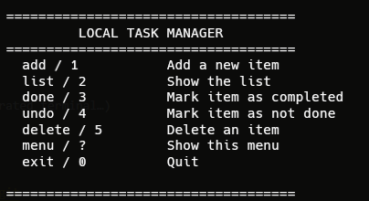
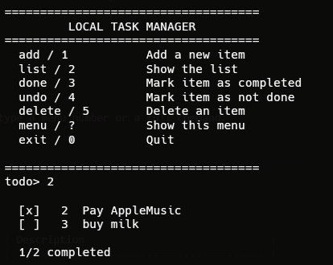

#  Local Task Manager

A command-line (CLI) application to manage a to-do list, written in **pure Python** with local JSON storage. No external dependencies.


---

##  Features

-  Interactive menu **and** one-line typed commands
-  Add, list, complete, reopen and delete tasks
-  Automatic saving to `tasks.json` (next to the script)
-  Python standard library only — zero dependencies
-  Portable: copy the folder anywhere and it keeps working
-  Works on Windows, macOS and Linux

##  Requirements

- Python **3.8** or newer
- A terminal (Windows Terminal, PowerShell, cmd, VS Code integrated terminal…)

##  Installation

```bash
git clone https://github.com/YOUR-USERNAME/local-task-manager.git
cd local-task-manager
```

Nothing to install. If you have Python, you're ready to go.

Alternatively, download the ZIP from the **Code → Download ZIP** button and unzip it.

##  Usage

```bash
python Todo.py
```

The menu is displayed and the `todo>` prompt appears. You can type a menu number or a full command:

```


```

### Commands

| Command                    | Aliases                  | Menu | Description                              |
| -------------------------- | ------------------------ | :--: | ---------------------------------------- |
| `add       `               | `add`                    | `1`  | Add a task. Without text, prompts for it.|
| `list`                     |                          | `2`  | Show all tasks                           |
| `done     `                | `d`, `complete`          | `3`  | Mark a task as completed                 |
| `undo     `                | `u`, `reopen`            | `4`  | Mark a task as not completed             |
| `delete     `              | `del`, `rm`, `remove`    | `5`  | Delete a task (asks for confirmation)    |
| `menu`                     | `m`, `?`                 |      | Show the help menu                       |
| `exit`                     | `quit`, `q`              | `0`  | Quit the program                         |

> The `<id>` in `done`, `undo` and `delete` is **optional**. If omitted, the program shows the list and asks which task you mean.

### Tips

- Quotes are accepted and stripped: `add "Buy milk"` is the same as `add Buy milk`.
- Press `Ctrl+C` at any time to exit — your data is saved before quitting.

##  Where the data is stored

Next to the script, in `tasks.json`:

```json
[
  {
    "id": 1,
    "title": "Buy milk",
    "completed": true,
    "created": "2026-11-02T14:32:10"
  }
]
```

It's a human-readable JSON file you can edit by hand. **Don't commit it to the repo** — it's already listed in `.gitignore`.

##  Project structure

```
local-task-manager/
├── Todo.py        # the application
├── README.md
├── LICENSE
└── .gitignore     # (tasks.json is not tracked)
```

##  Contributing

Ideas, pull requests and suggestions are welcome. Open an **issue** with whatever you have in mind.

Ideas for future additions:
- Filters `list --pending` / `list --done`
- Due dates (`add "..." --due 2026-12-01`)
- Priorities
- Search (`search <word>`)
- SQLite backend (still no dependencies thanks to `sqlite3` in the stdlib)

##  License

[MIT](LICENSE)